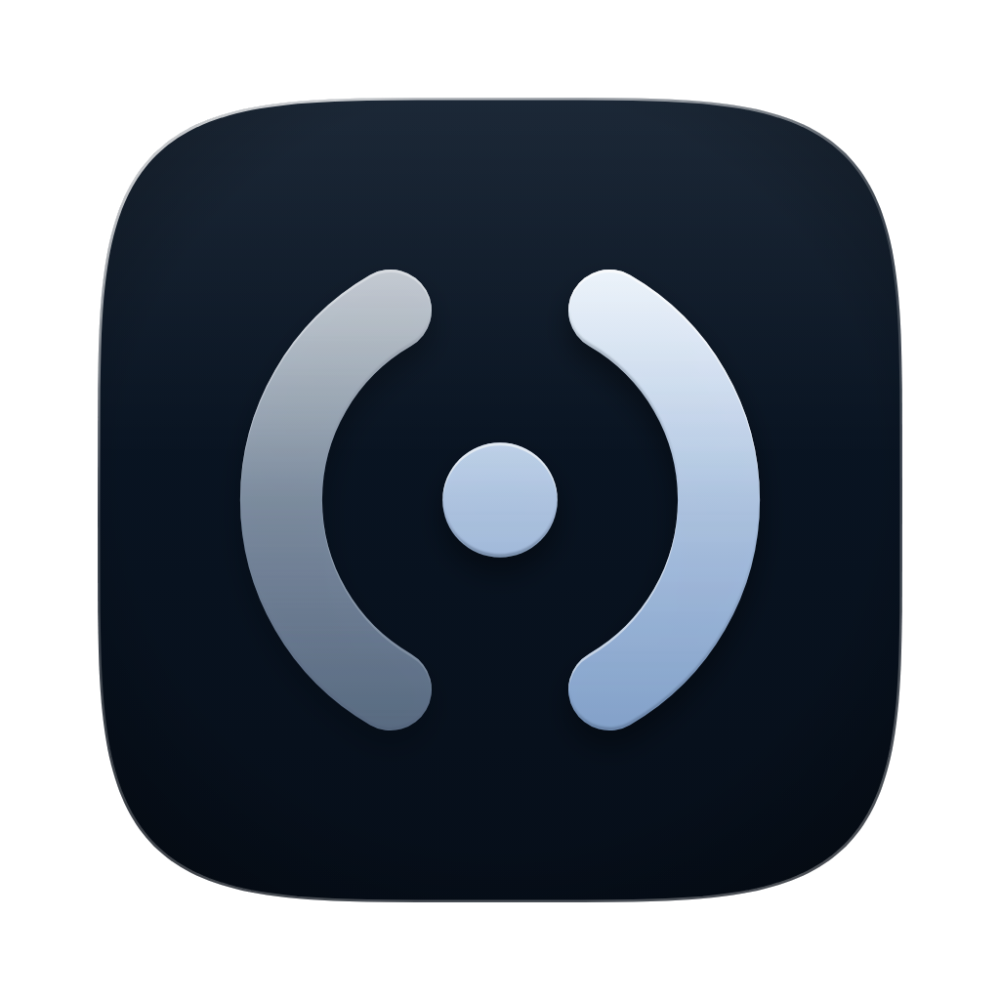

# ORBIO

[](https://github.com/serdarabdulkadir/ORBIO/actions/workflows/ci.yml)
[](https://github.com/serdarabdulkadir/ORBIO/releases/latest)
[](LICENSE)

English | [Turkce](README.tr.md)

ORBIO is a macOS menu bar app with an Android companion for managing your own Bluetooth earbuds: battery, noise control, audio switching and a proximity card, with a Mac and a phone working together. It targets QCY MeloBuds and, experimentally, Apple AirPods and Beats.

<p align="center"></p>

## Features

- Battery for left bud, right bud and case, with low-battery alerts.
- Noise control modes (off / noise cancelling / transparency) and ANC scenes where the earbuds support them.
- Equalizer presets, touch controls, wear detection and game mode (QCY).
- Audio switching between your Mac and your phone, optional automatic switching.
- Proximity card on the Mac when earbuds are opened nearby.
- Phone channel: pair your Android phone with the Mac over the local network to see phone state, answer or reject calls, search contacts and recent calls. Every capability is off by default and controlled on the phone.
- Android app: control the earbuds directly from the phone.

## Supported devices

| Device | Status | Notes |
|---|---|---|
| QCY MeloBuds Pro | Supported | Developed and tested on real hardware. |
| Apple AirPods family (Pro, Max, 1-4) and Beats | **Experimental** | New. Battery and state are read from Apple's public proximity advertisements. Not yet verified on real hardware. Expect gaps. |
| Other earbuds | Not supported | See the device-support issue template to help add one. |

ORBIO is for your own devices and interoperability only. Encrypted fields are not decrypted, no client is built for vendor servers, and no identity is spoofed.

## Install (macOS)

Requires macOS 15 or newer.

```bash
curl -fsSL https://raw.githubusercontent.com/serdarabdulkadir/ORBIO/main/install.sh | bash
```

The script finds the latest release, verifies its SHA-256, installs `ORBIO.app` to `/Applications` (or `~/Applications`) and opens it. Options: `--version vX.Y.Z`, `--no-open`, `--uninstall`, `--android`, `--help`. You can read the script before running it: [install.sh](install.sh).

**The app is not notarized.** It is ad-hoc signed, so macOS Gatekeeper would block a browser download. The installer removes the quarantine flag (`xattr -dr com.apple.quarantine`) after verifying the checksum. If you do not want that, build from source.

Manual install: download `ORBIO-macos-<version>.zip` from [Releases](https://github.com/serdarabdulkadir/ORBIO/releases/latest), check it against the `.sha256` file, unzip, move `ORBIO.app` to Applications, then right-click and Open (or run `xattr -dr com.apple.quarantine /Applications/ORBIO.app`).

Build from source (Swift 6 toolchain, macOS 15):

```bash
git clone https://github.com/serdarabdulkadir/ORBIO.git
cd ORBIO
swift build && swift test
scripts/paketle.sh --ac        # builds ORBIO.app into ~/Applications and opens it
```

## Install (Android)

Android 8.0 (API 26) or newer.

1. Download `ORBIO-android-<version>.apk` from [Releases](https://github.com/serdarabdulkadir/ORBIO/releases/latest), or run `install.sh --android` on your Mac (downloads the APK to `~/Downloads` and installs it with `adb` if a device is connected).
2. Allow installation from unknown sources for your browser or file manager.
3. Open ORBIO, grant the Bluetooth permissions, and optionally pair with your Mac from the Phone tab.

Release APKs are signed with the project key when one is configured; otherwise with a debug key (the release notes say which). Updates over a different signing key require uninstalling first.

Build from source: `cd Android && ./gradlew testDebugUnitTest assembleDebug` (JDK 17, Android SDK 35). See [Android/README.md](Android/README.md).

## Permissions and privacy

- No cloud, no accounts, no telemetry, no analytics.
- Mac: Bluetooth (find the earbuds, read battery and state) and Local Network (talk to your phone).
- Phone and Mac talk only on the same local network, over an encrypted, paired channel (P-256 ECDH, HKDF, AES-GCM, with a 6-digit code confirmation and key pinning). Protocol: [docs/telefon-kanali.md](docs/telefon-kanali.md).
- Android: Bluetooth scan/connect; phone state, call, contacts and call-log permissions are requested only when you enable the matching feature. Contacts and call history never leave the local network and are not stored in the cloud.

## Limits

- Not notarized (see above). macOS 15+ only.
- Android cannot see the moment the other party answers (privileged API); some phones restrict background apps (battery optimization).
- Earbud control depends on what the firmware exposes; unverified behavior is labeled experimental in the UI and docs.
- ORBIO is not a replacement for vendor firmware updates.

## Documentation

See [docs/README.md](docs/README.md).

## Contributing

Issues and pull requests are welcome. Read [CONTRIBUTING.md](CONTRIBUTING.md) and the [Code of Conduct](CODE_OF_CONDUCT.md). For security problems see [SECURITY.md](SECURITY.md).

## Trademarks

QCY, Apple, AirPods, Beats and other names are trademarks of their respective owners. ORBIO is independent and is not affiliated with, endorsed by or sponsored by them.

## License

[MIT](LICENSE) (c) ORBIO contributors.
