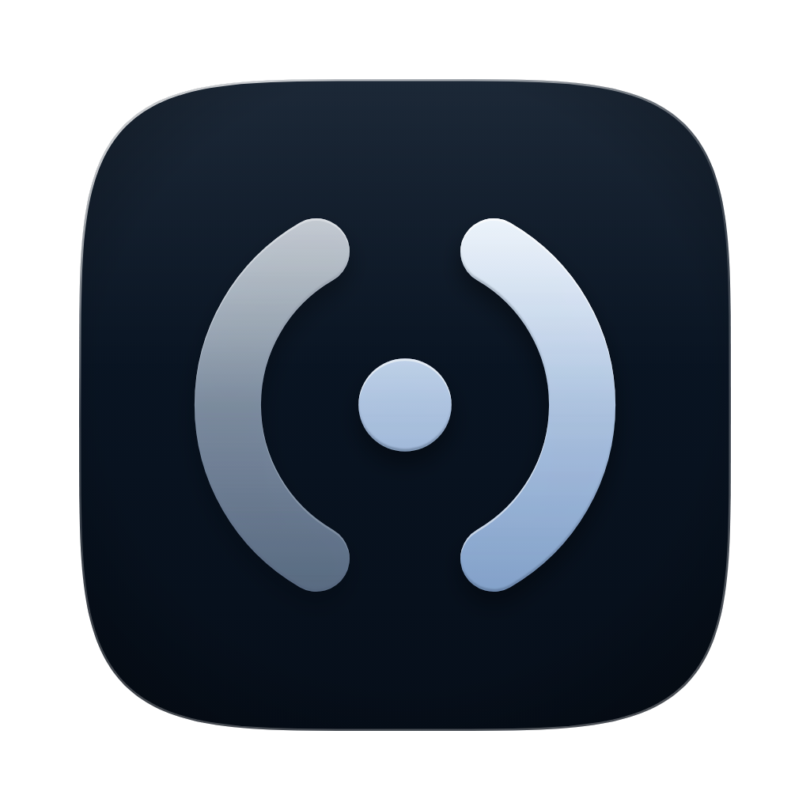

# ORBIO

[](https://github.com/serdarabdulkadir/ORBIO/actions/workflows/ci.yml)
[](https://github.com/serdarabdulkadir/ORBIO/releases/latest)
[](LICENSE)

[English](README.md) | Türkçe

ORBIO, kendi Bluetooth kulaklıklarını yönetmek için macOS menü çubuğu uygulaması ve Android yardımcı uygulamasıdır: pil, gürültü kontrolü, ses geçişi ve yaklaşma kartı; Mac ve telefon birlikte çalışır. QCY MeloBuds'ı hedefler; Apple AirPods ve Beats desteği deneyseldir.

<p align="center"></p>

## Özellikler

- Sol, sağ kulaklık ve kutu pili; düşük pil uyarısı.
- Gürültü kontrol modları (kapalı / gürültü engelleme / şeffaf) ve kulaklık destekliyorsa ANC sahneleri.
- Ekolayzer ön ayarları, dokunmatik kontroller, kulak algılama ve oyun modu (QCY).
- Mac ile telefon arasında ses geçişi, isteğe bağlı otomatik geçiş.
- Kulaklık yakında açılınca Mac'te yaklaşma kartı.
- Telefon kanalı: Android telefonu yerel ağda Mac ile eşleştir; telefon durumunu gör, aramaları cevapla/reddet, kişilerde ve son aramalarda ara. Her yetenek varsayılan olarak kapalıdır ve telefondan yönetilir.
- Android uygulaması: kulaklığı doğrudan telefondan kontrol et.

## Desteklenen cihazlar

| Cihaz | Durum | Not |
|---|---|---|
| QCY MeloBuds Pro | Destekli | Gerçek cihazda geliştirildi ve denendi. |
| Apple AirPods ailesi (Pro, Max, 1-4) ve Beats | **Deneysel** | Yeni. Pil ve durum Apple'ın herkese açık yakınlık yayınlarından okunur. Gerçek cihazda henüz doğrulanmadı; eksikler olabilir. |
| Diğer kulaklıklar | Desteklenmiyor | Eklemek için cihaz desteği issue şablonunu kullan. |

ORBIO yalnızca kendi cihazların ve birlikte çalışabilirlik içindir. Şifreli alanlar çözülmez, üretici sunucuları için istemci yazılmaz, kimlik taklidi yapılmaz.

## Kurulum (macOS)

macOS 15 veya üzeri gerekir.

```bash
curl -fsSL https://raw.githubusercontent.com/serdarabdulkadir/ORBIO/main/install.sh | bash
```

Betik son sürümü bulur, SHA-256'sını doğrular, `ORBIO.app`'i `/Applications`'a (olmazsa `~/Applications`) kurar ve açar. Seçenekler: `--version vX.Y.Z`, `--no-open`, `--uninstall`, `--android`, `--help`. Çalıştırmadan önce okuyabilirsin: [install.sh](install.sh).

**Uygulama notarize edilmemiştir.** Ad-hoc imzalıdır; tarayıcıdan inen hâlini macOS Gatekeeper engeller. Kurucu, sağlama toplamını doğruladıktan sonra karantina işaretini kaldırır (`xattr -dr com.apple.quarantine`). İstemiyorsan kaynaktan derle.

Elle kurulum: [Releases](https://github.com/serdarabdulkadir/ORBIO/releases/latest) sayfasından `ORBIO-macos-<surum>.zip` dosyasını indir, `.sha256` ile karşılaştır, aç, `ORBIO.app`'i Uygulamalar'a taşı; sağ tıklayıp Aç de (ya da `xattr -dr com.apple.quarantine /Applications/ORBIO.app`).

Kaynaktan derleme (Swift 6, macOS 15):

```bash
git clone https://github.com/serdarabdulkadir/ORBIO.git
cd ORBIO
swift build && swift test
scripts/paketle.sh --ac        # ORBIO.app'i ~/Applications'a kurar ve açar
```

## Kurulum (Android)

Android 8.0 (API 26) veya üzeri.

1. [Releases](https://github.com/serdarabdulkadir/ORBIO/releases/latest) sayfasından `ORBIO-android-<surum>.apk` dosyasını indir ya da Mac'te `install.sh --android` çalıştır (APK `~/Downloads`'a iner; cihaz bağlıysa `adb` ile kurulur).
2. Tarayıcın ya da dosya yöneticin için bilinmeyen kaynaklardan kuruluma izin ver.
3. ORBIO'yu aç, Bluetooth izinlerini ver; istersen Telefon sekmesinden Mac ile eşleş.

Sürüm APK'ları, yapılandırılmışsa proje anahtarıyla, yoksa debug anahtarıyla imzalanır (sürüm notunda yazar). Farklı anahtarla imzalı sürüme güncellemek için önce kaldırmak gerekir.

Kaynaktan derleme: `cd Android && ./gradlew testDebugUnitTest assembleDebug` (JDK 17, Android SDK 35). Bkz. [Android/README.md](Android/README.md).

## İzinler ve gizlilik

- Bulut yok, hesap yok, telemetri yok, analitik yok.
- Mac: Bluetooth (kulaklığı bulma, pil ve durum okuma) ve Yerel Ağ (telefonla konuşma).
- Telefon ile Mac yalnızca aynı yerel ağda, şifreli ve eşleştirilmiş kanalla konuşur (P-256 ECDH, HKDF, AES-GCM, 6 haneli kod onayı ve anahtar sabitleme). Protokol: [docs/telefon-kanali.md](docs/telefon-kanali.md).
- Android: Bluetooth tarama/bağlanma; telefon durumu, arama, kişiler ve arama geçmişi izinleri yalnızca ilgili özelliği açtığında istenir. Kişiler ve arama geçmişi yerel ağdan çıkmaz, bulutta saklanmaz.

## Sınırlar

- Notarize değil (yukarıya bak). Yalnızca macOS 15+.
- Android, karşı tarafın aramayı açtığı anı göremez (ayrıcalıklı API); bazı telefonlar arka plan uygulamalarını kısıtlar (pil optimizasyonu).
- Kulaklık kontrolü donanım yazılımının sunduklarına bağlıdır; doğrulanmamış davranış arayüzde ve belgelerde deneysel etiketlenir.
- ORBIO üretici yazılım güncellemelerinin yerini tutmaz.

## Belgeler

Bkz. [docs/README.md](docs/README.md).

## Katkı

Issue ve pull request'ler açıktır. [CONTRIBUTING.md](CONTRIBUTING.md) ve [Davranış Kuralları](CODE_OF_CONDUCT.md)'nı oku. Güvenlik sorunları için [SECURITY.md](SECURITY.md).

## Markalar

QCY, Apple, AirPods, Beats ve diğer adlar sahiplerinin ticari markalarıdır. ORBIO bağımsızdır; onlarla bağlantılı değildir, onlarca onaylanmamış veya desteklenmemiştir.

## Lisans

[MIT](LICENSE) (c) ORBIO contributors.
